# 无需测量前位状态的 CAN/CAN FD「取反型」干扰：六种替代实施方案

> 防御性公开（Defensive Publication） · 技术披露文本

| 项目 | 内容 |
|---|---|
| 公开日期 | 2026-10-31 |
| 版本 | v1.0 |
| 主题 | CAN / CAN FD / CAN XL 总线干扰仪中「使干扰值必然不同于原值」的实现方法 |
| 对标在先专利 | CN 118158132 B（总线报文的干扰方法及基于 FPGA 的干扰仪，上海同星智能科技有限公司，申请日 2024-03-14，授权公告日 2025-02-11） |
| 用途 | 建立现有技术（prior art），阻止他人在本方案基础上获得专利垄断 |
| 许可建议 | CC BY 4.0（便于被广泛引用、检索与作为现有技术举证） |

---

## 摘要

CN 118158132 B 的核心方法是：**先测量待干扰位之前一个脉宽 T 的报文显隐性，再对该位执行相反的注入（显性→隐性、隐性→显性）**。该方法的实质目的不是"取反"这个动作本身，而是**保证干扰后的位值必然与原值不同**，从而使发送节点在回读总线上检测到位错误（Bit Error）并触发错误帧。

本文公开**六种不需要"测量前一脉宽 T 的显隐性状态"即可达成同一目的**的技术路线，分别从三个维度回避：**判定依据**（改用协议先验、跨帧轮询、自身输出基准、总线跳变沿方向）、**物理注入方式**（改用单端对地拉低、双脉冲对）、**实现载体**（改用 MCU / CPLD / ASIC / 分立逻辑而非 FPGA 干扰单元）。

其中特别指出一点：常见的"位内双脉冲"方案**并不能保证命中**——一个位时间只有一个采样点，所以两个脉冲中只有一个可能被采到（详见第 5 章）。本文给出该方案的修正形态，并公开由**总线跳变沿方向反推本位状态**的边沿推断式翻转（方案 F）。每条路线均给出原理图、波形图、可实施细节与失效边界。

---

## 0. 法律边界与使用说明（务必先读）

本节不是法律意见，仅为技术披露的边界标注。

1. **本公开不能使 CN 118158132 B 无效。** 该专利申请日（2024-03-14）早于本公开日，本公开不构成其"申请日前的现有技术"。防御性公开的作用是：
   - 阻止任何人（包括原专利权人）**日后**就本文披露的方案再申请专利；
   - 在侵权比对或无效/异议程序中，作为**技术解释依据**，证明存在多种不采用"测量前一 T 显隐性"的等效实现路径；
   - 抑制专利丛林，降低同业后续申请的授权概率。
2. **公开即丧失自己申请专利的新颖性。** 在中国及绝大多数国家，GitHub 公开发布不属于《专利法》第 24 条列举的宽限期情形。**一旦发布，你本人也不能再就本文披露的方案申请专利。** 若其中某条路线你打算自己申请专利，请先移除该条再发布。
3. **本公开披露的是"方法思路"，不含任何第三方保密信息。** 文中涉及的器件型号（LMG1020、EPC2035 等）均为公开 datasheet 内容。
4. **公开范围需权衡。** 防御性公开要有效，必须"可实施（enabling）"，因而不可避免地暴露你的硬件拓扑。建议只公开到"本领域技术人员可复现"的程度，不公开具体的 PCB 参数、量产工艺与固件工程细节。

---

## 1. 在先专利的技术特征拆解

要回避，先要精确知道回避什么。CN 118158132 B 的独立方法权利要求（权 1）可拆为三个必要技术特征：

| 编号 | 特征 | 含义 |
|---|---|---|
| **F1** | 设定报文干扰精度的脉宽时间 T | 定义干扰的时间分辨率（说明书给出最小 5 ns） |
| **F2** | **判断待干扰位置的前一个脉宽时间 T 的报文的显隐性状态** | 通过接收通路（RXD）采样历史比特，得到"原值" |
| **F3** | 根据显隐性判断结果对待干扰位置的报文执行相应干扰操作 | F2 判为显性则强制隐性；判为隐性则强制显性（取反） |

从属权 2–5 追加了"取反 + 保持"组合、"双干扰位间隔取反"两种时序形态；权 6–10 追加了"基于 FPGA 的干扰单元 + 解码/干扰使能/触发使能/输出模块 + 收发器与开关管"的装置限定。

**关键结论：**

- **F2 是唯一的"状态感知"特征**，也是整套方案的实现难点。只要方案中不存在"对待干扰位之前一个 T 的原始报文状态进行显隐性判断"这一步，就不落入权 1 的字面范围。
- **F3 的"取反"也可被替换**：只要能保证"干扰后位值 ≠ 原值"，目的即达成，不必是逐位取反。
- **权 6 的载体限定（FPGA）** 可以用 MCU / CPLD / ASIC / 分立逻辑规避，但**仅换载体而不换方法仍然侵权**——载体回避必须与方法回避叠加使用。

---

## 2. 总体回避思路：三个正交维度

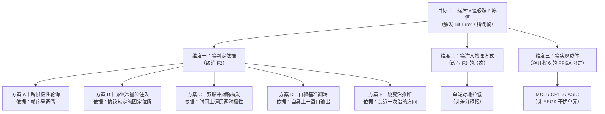

方案 A–D 与方案 F 共五条路线，解决"**怎么在不测量原值的前提下保证失配**"；方案 E 解决"**用什么硬件实现**"。两者需要组合使用。

---

## 3. 方案 A｜跨帧极性轮询（Polarity Polling）

### 3.1 原理

不做逐位判断，而是**以"帧"为单位轮换干扰极性**：第 1、3、5… 帧统一强制显性，第 2、4、6… 帧统一强制隐性（或按更细的 N 帧周期轮换）。

由于 CAN 报文绝大多数是**周期性重复帧**，同一个报文 ID 的同一个比特位会在多次发送中出现。只要极性遍历了 {显性, 隐性} 两种取值，则该位**必然至少有一次**被注入成与原值相反的值，从而必然触发一次位错误。

> 一句话：**用"时间维度上的遍历"替代"空间维度上的测量"**。

### 3.2 结构

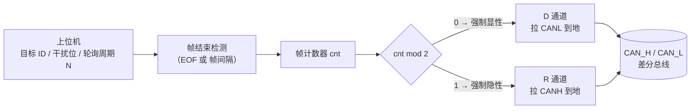

### 3.3 时序

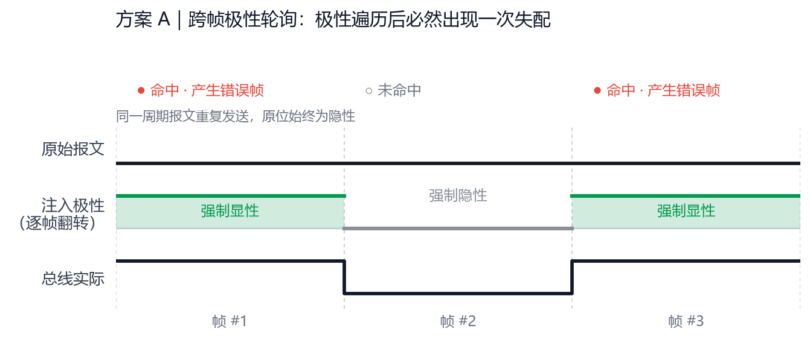

*图 1　同一周期报文连续三帧：注入极性逐帧翻转。第 1、3 帧命中并产生错误帧，第 2 帧因极性恰好与原值相同而未命中——极性遍历后必然至少命中一次。*

### 3.4 实施细节

- 轮询粒度可配置：`每帧轮换` / `每 N 帧轮换` / `按干扰位序号轮换`（同一帧内不同位用不同极性，进一步缩短命中时间）。
- 终止条件：检测到总线错误帧（或目标节点进入 Error Passive / Bus-off）后停止，避免过度干扰。
- 与"保持模式"等价的效果：单帧内从干扰位起持续保持同一极性，即可复现专利的"取反+保持"时序外观，但**极性来源是计数器而非测量**。

### 3.5 与在先专利的差异

| 特征 | 本方案 | 说明 |
|---|---|---|
| F1 脉宽 T | 具备 | 仅为时序参数，不构成区别 |
| F2 判断前一 T 显隐性 | **不具备** | 极性由帧计数器决定，与原报文内容完全无关 |
| F3 取反 | **形态不同** | 是"固定极性注入"，不构成逐位取反 |

### 3.6 评价

| 优点 | 缺点 |
|---|---|
| 零测量，硬件最简（一个计数器 + 两路驱动） | 单帧内**不保证**命中，需 2 帧以上 |
| 对 CAN / CAN FD / CAN XL 通用，无需解析帧结构 | 不适用于一次性（非周期）报文 |
| 可用极低成本的 CPLD 甚至纯计数器逻辑实现 | 平均干扰延迟增大，对"精确时序类"测试（采样点、毛刺）不适用 |

---

## 4. 方案 B｜协议常量位注入（Protocol-Constant Field Injection）

### 4.1 原理

CAN / CAN FD 帧中存在若干**取值由协议硬性规定、与数据内容无关的"固定格式位"**。对这些位，干扰方向**无需测量就能确定**：直接按协议要求的相反值注入，即可产生 Form Error（格式错误）。

这是唯一能做到"**单帧、单次、100% 确定命中**"且完全不需要测量的方案。

### 4.2 可用注入点清单

| 注入点 | 协议要求值 | 注入值 | 预期错误类型 | 说明 |
|---|---|---|---|---|
| **CRC 界定符** | 隐性 | 显性 | Form Error | CAN FD 中 CRC 序列后有 1 位固定隐性界定符 |
| **ACK 界定符** | 隐性 | 显性 | Form Error | ACK 槽之后紧邻 1 位隐性 |
| **EOF 第 k 位**（k=1..7） | 隐性 | 显性 | Form Error | 帧结束 7 位全隐性 |
| **帧间隔 / 总线空闲** | 隐性 | 显性 | 伪 SOF → 位不同步 / Form Error | 在 IFS 内注入显性会被当作新帧起始 |
| **错误帧界定符** | 隐性（8 位） | 显性 | Form Error | 在他人错误帧期间二次注入 |
| **过载帧界定符** | 隐性（8 位） | 显性 | Form Error | 同上 |
| **仲裁段 IDE / r0 / FDF 位** | 依帧类型固定 | 取反 | Form Error | 需区分标准帧/扩展帧/CAN FD 帧 |
| **CRC 序列的位填充位** | 依填充规则确定 | 制造第 6 位相同 | Stuff Error | 需实时统计连续相同位数（见 4.5） |

### 4.3 结构

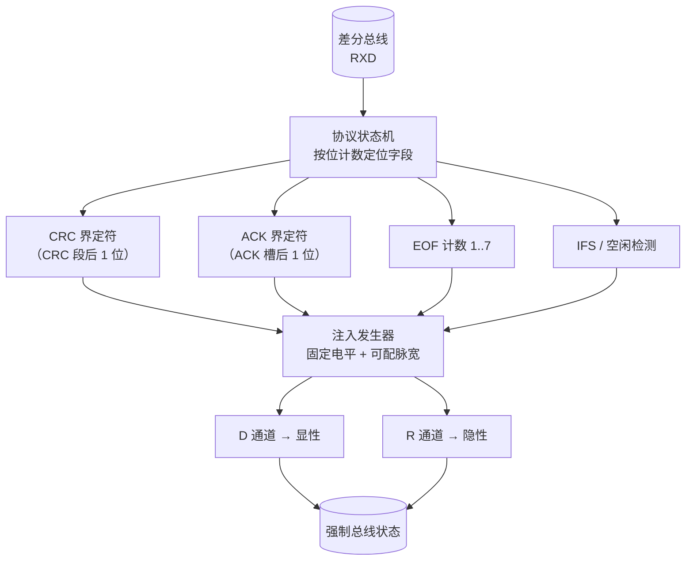

### 4.4 时序（以 CRC 界定符为例）

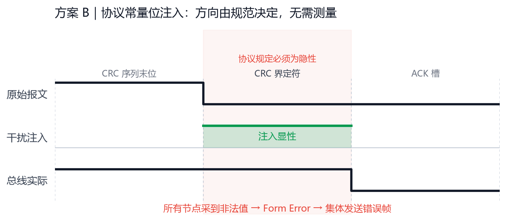

*图 2　CRC 界定符按协议必须为隐性，注入显性后所有节点均采到非法值，同时产生 Form Error 并集体发送错误帧。*

### 4.5 位填充违规的两种形态

- **形态 1（需观测）**：实时统计连续相同位的个数，在第 5 个相同位之后、第 6 位处强制注入**相同值**，制造 6 连同性 → Stuff Error。此形态需要读取总线，但判断依据是"连续相同位计数"，**不是"前一个 T 的显隐性"**，与 F2 存在实质差异。
- **形态 2（无需观测）**：仅在**帧尾固定字段**做文章（4.2 表中的前 6 项），完全依赖协议先验。

### 4.6 与在先专利的差异

| 特征 | 本方案 | 说明 |
|---|---|---|
| F1 脉宽 T | 具备（可更粗，甚至以"位"为单位） | 不构成区别 |
| F2 判断前一 T 显隐性 | **不具备** | 干扰方向由**协议规范**给出，是常量，与总线实际状态无关 |
| F3 取反 | **不具备** | 执行的是"固定值注入"，不是"对前一位取反" |

### 4.7 评价

| 优点 | 缺点 |
|---|---|
| 单次命中率 100%，可重复、可判定 | 注入点被限制在固定字段，**不能任意选位** |
| 无需 RXD 采样历史，甚至可在"只听不测"状态下工作 | 无法用于"数据段任意位"的定向测试 |
| 天然适配 Bus-off、错误帧检测、错误恢复时间等测试项 | 采样点测试、毛刺过滤测试需改用方案 C |
| 与传统 TH7011 类仪器的"强显/强隐"兼容，升级成本最低 | —— |

---

## 5. 方案 C｜双脉冲对称扰动（Dual-Pulse Symmetric Disturbance）

### 5.1 原理与设计意图

在**同一个目标位的时间内**，先后注入两个窄脉冲，极性相反（先显性后隐性，或先隐性后显性），两个脉冲的宽度都显著小于位时间。

设计意图是：原值只可能是 {显性, 隐性} 中的一种，而注入序列**遍历了两种极性**，于是希望"总有一个脉冲与原值相反"。**但这个意图在理论上不成立**，原因见 5.2。

### 5.2 时序与致命缺陷：一个位时间只有一个采样点

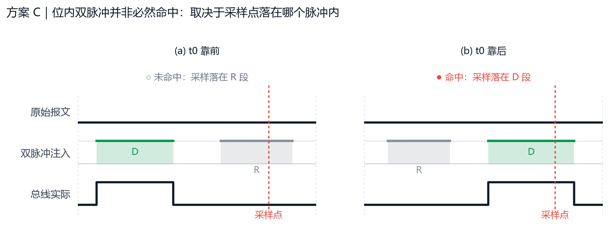

*图 3　情形 (a)：采样点落在 R 脉冲内，采到隐性 = 原值 → 干扰失败；情形 (b)：采样点落在 D 脉冲内，采到显性 ≠ 原值 → 命中。同一位内的两个脉冲，只有一个能覆盖采样点。*

接收节点每个位时间**只采样一次**（典型位置为位时间的 75%–87.5%）。因此：

- D、R 两个脉冲里，**只有一个**能覆盖采样点，另一个被采样点完全"忽略"；
- 若覆盖采样点的那个脉冲**恰好与原值同极性**，采样结果就等于原值，**不会产生位错误**；
- 单帧、单次注入的命中概率约为 **50%**（数据极性均衡时），且命中与否取决于**采样点位置与脉冲位置的相对关系**，即取决于 DUT 的采样点设置——这是一个干扰仪不可控的外部变量。

> 结论：**"位内双脉冲"不是确定性干扰**。它只是把 50% 的单极性命中率包装成"双极性"，在不掌握 DUT 采样点的情况下无法保证单帧命中。

### 5.3 修正形态：单帧内遍历不可行，改为跨帧遍历

把"极性遍历"从**一个位时间内**移到**多帧之间**：第 1 帧让 D 脉冲对准采样点、第 2 帧让 R 脉冲对准采样点（脉冲顺序逐帧互换）。这样两帧之内必然有一帧命中——本质上是方案 A 的时序特例，但保留了方案 C 的"窄脉冲"能力，因此仍是采样点测试与毛刺过滤测试的合适工具：

- **采样点扫描**：逐帧把 `t0` 前移 1 个 tq，记录"开始误采样"的 t0 区间，即得 DUT 的实际采样点；
- **毛刺过滤测试**：注入宽度小于规范滤波宽度的脉冲，若 DUT 仍被误采样，即判定滤波失效；
- **组合**：脉冲极性由帧计数器决定（方案 A），脉冲位置由 `t0` 决定（方案 C）。

**参数建议**：`脉冲宽度 w` 取 0.15–0.35 个位时间，两脉冲间隔 `gap` 取 0.1–0.3 个位时间。

### 5.4 结构

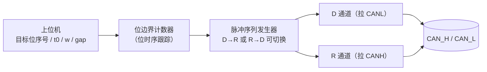

### 5.5 变体

- **三脉冲**：D → R → D，可略微提高单帧命中率，但仍不是 100%。
- **对称双脉冲（等宽）** 适合"毛刺过滤测试"：接收节点本应滤除短于 w 的毛刺，若其仍被误采样，即判定滤波失效。
- **跨帧互换脉冲顺序**：把"单帧内遍历"改为"跨帧遍历"，两帧内必中（推荐形态）。

### 5.6 与在先专利的差异

| 特征 | 本方案 | 说明 |
|---|---|---|
| F1 脉宽 T | 具备 | 不构成区别 |
| F2 判断前一 T 显隐性 | **不具备** | 不关心原位值；单帧内只有一个脉冲被采样，靠**跨帧轮换脉冲顺序**才保证覆盖 |
| F3 取反 | **形态不同** | 是"双极性脉冲对"，不产生"与前一 T 相反的电平" |

### 5.7 评价

| 优点 | 缺点 |
|---|---|
| 跨帧遍历后两帧内必中，**且可在任意数据位使用** | 需要纳秒级精确的位边界跟踪与脉冲整形 |
| 天然可用于**采样点测试**与**毛刺过滤测试**（专利方案的"双位间隔取反"也想覆盖这两项） | 对驱动级带宽要求高；大电流双脉冲的 EMI 与热负荷需评估 |
| 脉冲宽度/位置全部可参数化，测试可自动化 | 若 DUT 采样点极靠近位边界，t0 需精细校准 |

---

## 6. 方案 D｜自驱基准翻转（Seeded Toggle）

### 6.1 原理

干扰窗口内，**总线状态由干扰仪主导**。因此干扰仪**自己上一时刻的输出值就是总线当前值**——这个值来自干扰仪的**输出寄存器**，不是测量结果。

做法：先把目标窗口强制为一个**已知值**（例如显性），再对**自身输出寄存器**取反，即可保证产生一次确定的电平跳变。整个过程中，从未对"原始报文的显隐性"做任何判断。

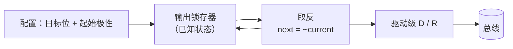

### 6.2 时序

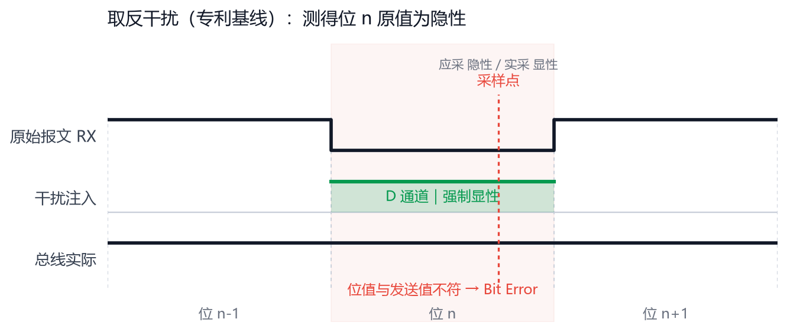

*图 4　先把窗口强制为已知电平，再对自身输出取反，必然产生一次确定的电平跳变。波形外观与"测量后取反"相同，差别在于基准值来自**自身输出寄存器**，而非对原报文的测量。*

### 6.3 与在先专利的差异与风险

- **差异**：F2 被"读取自身上一输出寄存器"取代，逻辑上不是"判断报文显隐性"。
- **风险提示**：若审查/司法环节认为"自身上一输出 = 总线前一位状态"，本方案可能被认定为等同替换。**建议不作为主方案**，仅作为补充实施例写入公开文本（用于扩大现有技术池）。

### 6.4 评价

适用于"仅需保证产生边沿/触发错误帧"的场景，不适用于严格的"逐位取反"语义测试。

---

## 7. 方案 F｜跳变沿推断式翻转（Edge-Polarity Inference）

> 本方案由本项目作者独立提出，本文公开的目的是把它固定为现有技术。

### 7.1 原理

不采样"前一个脉宽 T 的电平"，而是**记录总线最近一次跳变沿的方向**。CAN 采用 NRZ 编码，没有跳变时电平保持，因此：

- **上升沿（隐性 → 显性）** 之后，总线进入显性；在下一个沿出现之前，电平一直保持显性；
- **下降沿（显性 → 隐性）** 之后，总线进入隐性；同样保持到下一个沿。

所以"**最近一次沿的方向** + **沿后无新沿**"就足以确定当前位的原值：

| 最近一次沿 | 当前位原值 | 应注入 |
|---|---|---|
| 上升沿（隐→显） | 显性（0） | 隐性（1） |
| 下降沿（显→隐） | 隐性（1） | 显性（0） |

据此直接注入相反值，即为翻转干扰。本方案的关键特征是**零时延**：不需要 T 的延时线，不需要对历史电平做采样保持，判据是**事件（沿的极性）**而不是**电平（采样值）**。

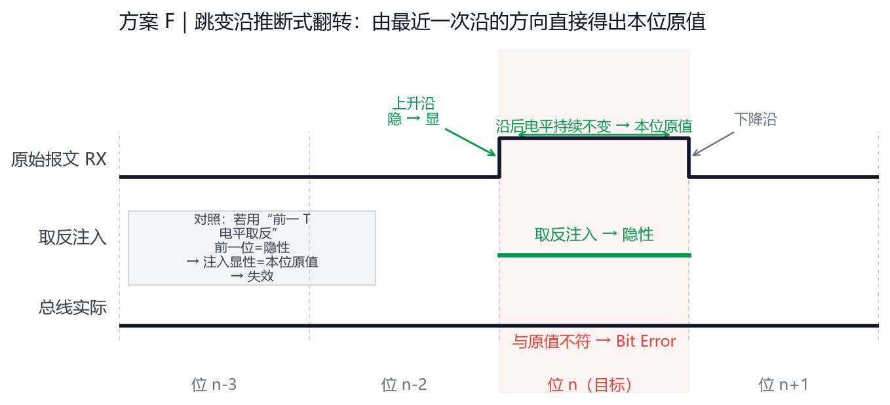

*图 5　位 n 的起点处为上升沿，故本位原值必为显性；直接注入隐性即可必然失配。左侧对照框说明：若改用"前一 T 电平取反"，因前一位为隐性，取反后恰等于本位原值，干扰反而失效。*

### 7.2 结构

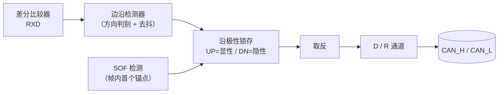

### 7.3 与在先专利的比对：算不算绕过

| 权 1 特征 | 在先专利 | 本方案 F | 判断 |
|---|---|---|---|
| F1 设定脉宽 T | 必须设定 T | **不设 T**，无延时线，判决零时延 | 字面不同 |
| F2 判断前一脉宽 T 的报文显隐性 | 对"前一 T"的电平做采样判决 | 对"最近一次沿的方向"做事件判决，直接得出**本位**原值 | 字面不落入 |
| F3 根据结果取反 | 显→隐、隐→显 | 相同 | **字面落入** |

**结论：** 字面上不满足 F2（既没有"前一脉宽时间 T"这个时间窗，也没有对该窗口的电平采样），因此不落入权 1 的字面范围；但 F3 完全落入，所以最终是否侵权**取决于 F2 是否被认定为等同替换**。

**等同风险评级：中等。** 支持非等同的技术依据见 7.4；折旧风险来自"两者目的一致（得到原值后取反）"。因此建议把本方案与第 8 章的载体/物理层差异**叠加使用**，不要单独实施。

### 7.4 可用的差异化技术依据：位边界处两者结果相反

这是本方案最硬的抗辩点：

- **专利方案**取"待干扰位置之前一个 T"的电平。当干扰点恰好落在**位边界**上时，"前一个 T"属于**上一位**，而上一位与本位必然相反；取反之后得到的值**恰好等于本位的原值** → **干扰失效**（图 5 左侧对照框）。
- **本方案**由沿方向直接得到**本位**的原值，在位边界处同样正确。

也就是说，两者在"干扰点位于位边界"这一工况下**技术效果相反**，不满足"实质相同的技术手段、相同的技术效果"，据此可主张不属于等同替换。

### 7.5 失效边界与实施要点

| 风险 | 说明 | 对策 |
|---|---|---|
| 帧内首个锚点 | 第一个沿之前无法推断电平 | 以 **SOF 下降沿**（空闲隐性 → 显性）作为帧内锚点，或由帧结构解析器给出初始值 |
| 振铃/毛刺被误判为沿 | 差分总线在快速边沿处会出现振铃，可能被当成多次跳变 | 沿检测加**去抖窗口**（≥ 1/4 位时间）或模拟 RC 滤波；只接受单次方向变化 |
| 仲裁段多节点并发驱动 | 多节点同时驱动时沿的方向可能受他人影响 | 干扰窗口限制在**数据段 / CRC 段**，或配合滤波 |
| BRS 速率切换 | 数据段位时间缩短，沿密度变高 | 沿检测带宽按数据段速率设计；位计数器随 BRS 切换分频 |
| 错误帧期间的连续显性位 | 错误帧为 6 个连续显性位，可能被误认为新的数据沿 | 检测到错误帧即终止干扰窗口 |
| 长游程无沿 | 连续相同位期间没有沿 | 位填充规则保证游程 ≤ 5 位，沿后电平保持有效，不影响判断 |

### 7.6 评价

| 优点 | 缺点 |
|---|---|
| 零时延、无需 T 参数、无需历史电平采样 | F3 字面落入，等同风险中 |
| 在位边界处仍正确（专利方案在此失效） | 依赖沿检测质量，振铃场景需滤波 |
| 硬件极轻：一个边沿检测器 + 一个极性锁存器 | 仲裁段不宜使用 |
| 可与方案 A（极性轮询）、方案 E（载体替代）自由叠加 | —— |

## 8. 方案 E｜物理层与实现载体替代

本方案不改变"判定逻辑"，只改变**硬件实现**，用于回避权 6–10 的装置限定（"基于 FPGA 的干扰单元"+"收发器与开关管短接差分总线"）。

### 8.1 物理注入方式对比

| 注入方式 | 实现 | 显性强制 | 隐性强制 | 与权 9 的关系 |
|---|---|---|---|---|
| 专利方案 | CAN 收发器 + MOS 管**短接差分总线** | 收发器 TXD 拉低 | MOS 管栅极高，短接 CANH–CANL | 落入 |
| **本方案 E1** | 双通道低边驱动，**单端对地拉低** | 拉 **CANL** 到地 → 差分正 → 显性 | 拉 **CANH** 到地 → 差分负 → 隐性 | 不同：非差分短接，非收发器 + 开关管组合 |
| **本方案 E2** | 电流注入 / 共模偏置 | 向 CANL 注入电流 | 向 CANH 注入电流或抬升共模 | 不同：模拟域，无数字化"干扰控制信号" |

参考实现（公开 datasheet 器件）：

```
        +5V ──┬───────────────┬──────────
              │               │
        [LMG1020] D通道    [LMG1020] R通道
              │               │
        [EPC2035]           [EPC2035]
              │ 10Ω           │ 10Ω
              ├── CAN_L        ├── CAN_H
              │               │
        （低边拉地 = 强制显性）  （低边拉地 = 强制隐性）
```

要点：
- 低边 GaN 驱动可做到 **纳秒级边沿**，足以支撑 5 ns 级的脉宽 T；
- **无需与被测节点的收发器共用**，属于"外加注入级"，结构上不等同于权 9 的"收发器 + 开关管"；
- R 通道（拉 CANH）的限流电阻需按脉冲功率选型（≥1 W 脉冲能力的 1206 封装），避免连续双脉冲工况过热；
- 驱动级与监听级应在连接器处**单点接地汇合**，避免大电流脉冲耦合进 RXD 采样通路（若方案仍需读取总线）。

### 8.2 实现载体对比

| 载体 | 是否落入权 6 的"基于 FPGA" | 说明 |
|---|---|---|
| FPGA | **是** | 专利明示 |
| CPLD | 可能被认定等同 | 同为可编程逻辑器件，风险中等 |
| MCU（带硬件定时器/HRPWM） | **否**（字面） | 成本低，纳秒级抖动需用 HRPWM 或外部延时线 |
| ASIC / SoC | **否** | 量产最优 |
| 分立逻辑（计数器 + 比较器 + 延时线） | **否** | 纯硬件，无"解码模块/干扰使能模块"的软件化结构 |
| 模拟电路（比较器 + D 触发器 + 单稳态） | **否** | 连"数字解码"环节都不存在 |

> 注意：**载体回避不能独立成立**。若仍采用"测量前一 T 显隐性再取反"的方法，则权 1 方法权仍然被侵犯（方法权不受载体限制）。载体回避必须与方案 A/B/C 之一组合。

### 8.3 推荐组合

| 组合 | 方法权（权 1） | 装置权（权 6–10） | 适用场景 |
|---|---|---|---|
| **B + E1 + MCU** | 不落入 | 不落入 | 通用一致性测试（Bus-off、错误帧、错误恢复），成本最低 |
| **C + E1 + FPGA/ASIC** | 不落入 | 载体需注意 | 采样点测试、毛刺过滤测试等时序类项目 |
| **F + E1 + 分立逻辑** | 不落入（F2 字面不同，等同风险中等） | 不落入 | 单帧即中、零时延的逐位翻转，需沿检测质量保障 |
| **A + E2 + 分立逻辑** | 不落入 | 不落入 | 低成本便携式干扰盒 |

---

## 9. 特征对照矩阵

| 权 1 特征 | 专利 CN118158132B | A 轮询 | B 协议常量 | C 双脉冲 | D 自驱基准 | E 载体替代 | F 沿推断 |
|---|---|---|---|---|---|---|---|
| F1 设定脉宽 T | ✅ | ✅ | ✅（可用位为单位） | ✅ | ✅ | ✅ | ❌（无 T，零时延） |
| F2 **判断前一 T 显隐性** | ✅ | ❌ | ❌ | ❌ | ⚠️（改判自身输出） | 取决于所配合的方法 | ⚠️（改判沿方向，等同风险中） |
| F3 逐位取反 | ✅ | ❌（固定极性） | ❌（固定常量） | ❌（双极脉冲） | ⚠️（对自身取反） | 取决于所配合的方法 | ✅（字面具备） |
| 保证失配的机制 | 逐位测量后取反 | 跨帧遍历极性 | 协议先验常量 | 单帧遍历极性（**不保证**） | 强制已知态后翻转 | —— | 由沿方向直接得出本位原值 |
| 单帧命中 | ✅ | ❌（需 ≥2 帧） | ✅ | ❌（约 50%） | ✅ | —— | ✅ |
| 任意位可选 | ✅ | ✅ | ❌（限固定字段） | ✅ | ✅ | —— | ✅ |
| 需要 RXD 条件 | ✅ | ❌ | ❌（形态 2） | ❌ | ❌ | —— | ✅（仅需边沿检测，不需电平采样） |

（✅ 具备 / ❌ 不具备 / ⚠️ 存在等同风险）

---

## 10. 可实施细节

### 10.1 方案 A 的控制逻辑（伪代码）

```verilog
// 跨帧极性轮询：帧结束时刻翻转极性
reg pol = 1'b0;            // 0 = 隐性(R)，1 = 显性(D)

always @(posedge clk) begin
    if (frame_end_pulse)          // 由 EOF/IFS 检测产生
        pol <= ~pol;
end

assign jam_d = win_active &  pol;   // D 通道：拉 CANL 到地 → 显性
assign jam_r = win_active & ~pol;   // R 通道：拉 CANH 到地 → 隐性
```

### 10.2 方案 C 的脉冲发生（伪代码）

```verilog
// 一个目标位内产生 D→R 双脉冲，t0/w/gap 由上位机配置
localparam integer TQ_NS = 25;     // 示例：数据段位时间 25 ns（40 Mbps 等效场景）

// t0 后可配置偏移启动，先 D 后 R
assign jam_d = win_active & (delay_cnt >= T0) & (delay_cnt <  T0 + W);
assign jam_r = win_active & (delay_cnt >= T0 + W + GAP)
                       & (delay_cnt <  T0 + 2*W + GAP);
```

### 10.3 方案 B 的定位逻辑（伪代码）

```verilog
// 协议状态机：从 SOF 起按位计数，定位固定字段
case (bit_idx_after_sof)
  CRC_DELIMITER_INDEX : inject_pulse(DOMINANT);  // 应隐性 → 注入显性
  ACK_DELIMITER_INDEX : inject_pulse(DOMINANT);
  EOF_INDEX + 0..6    : inject_pulse(DOMINANT);
  default             : ;
endcase
```

### 10.4 验证方法

| 验证项 | 方法 |
|---|---|
| 是否真的产生错误帧 | 第二节点（或 CTU CAN FD 核，使能 `ERFM`）读取错误帧计数；同时用差分探头观测物理层 |
| 脉冲宽度/位置精度 | 差分探头 + 示波器分段存储，触发于干扰窗口 |
| 方案 A 的命中概率 | 周期性发帧 ≥ 20 帧，统计错误帧出现次数（应趋近 100%） |
| 方案 C 的采样点定位能力 | 逐帧步进 `t0`（步长 1 个 tq），记录误采样发生的 t0 区间，即 DUT 采样点 |

> 测量注意：CAN_H / CAN_L 为浮地差分对，**禁止用两个单端探头做 CH1−CH2 数学运算**，必须使用专用差分探头。

---

## 11. 术语表

| 术语 | 含义 |
|---|---|
| 显性（Dominant） | 逻辑 0，差分电压约 2 V（CANH 高、CANL 低） |
| 隐性（Recessive） | 逻辑 1，差分电压约 0 V |
| 脉宽时间 T | 干扰的时间分辨率单位（专利中最小 5 ns） |
| D 通道 | 强制显性的驱动通道（本方案中为拉低 CANL） |
| R 通道 | 强制隐性的驱动通道（本方案中为拉低 CANH） |
| Bit Error | 发送节点回读总线，发现与自身发送值不一致 |
| Form Error | 固定格式位出现非法值（CRC 界定符、ACK 界定符、EOF 等） |
| Stuff Error | 出现 6 个连续相同位（违反位填充规则） |
| IFS | Intermission / 帧间隔，3 位隐性 |

---

## 12. 拟公开的技术方案清单（用于建立现有技术）

以下编号陈述用于在检索与举证时提供清晰的"公开内容边界"。**不含任何方法权利要求式的排他意图**，仅为现有技术的事实记载。

1. 一种总线干扰方法，以**帧序号**决定干扰极性：第 N 帧强制显性、第 N+1 帧强制隐性，交替注入，使同一比特位在重复发送中至少一次获得与原值相反的值；不包含对待干扰位之前一个脉宽时间内报文显隐性状态的判断。
2. 根据权利要求 1，极性轮换周期 N 可配置，且同一帧内不同干扰位可使用不同极性。
3. 一种总线干扰方法，在**协议规定的固定取值的字段**（CRC 界定符、ACK 界定符、EOF、帧间隔、错误帧/过载帧界定符、IDE/r0/FDF 位）注入与协议规定值相反的电平，从而必然产生格式错误；干扰方向由协议规范确定，与总线实际状态无关。
4. 根据权利要求 3，所述注入点由帧结构状态机按 SOF 起始的位计数定位，位计数可随仲裁段长度（标准帧/扩展帧）与速率切换点自适应。
5. 一种总线干扰方法，在**同一目标位时间内**先后注入两个极性相反的窄脉冲，脉冲宽度小于位时间；因接收节点每个位时间仅采样一次，两个脉冲中只有一个可能被采到，故单帧单次命中率约为 50%，需通过**跨帧轮换脉冲顺序**（或方案 A 的帧计数极性）在两帧内保证命中。
6. 根据权利要求 5，脉冲对之间的起始偏移 t0、脉冲宽度 w、间隔 gap 均可配置，并通过逐帧步进 t0 实现被测节点采样点的自动测量。
7. 根据权利要求 5，脉冲对用于毛刺过滤测试：以短于规范滤波宽度的脉冲注入，若被测节点仍响应则判定其滤波功能失效。
8. 一种总线干扰装置，先把目标窗口强制为已知电平，再对**自身输出锁存器**取反，从而保证产生确定电平跳变；该装置不包含对原始报文显隐性状态的测量环节。
9. 一种总线干扰装置，其注入级由**两路独立低边驱动**构成：一路将 CANL 拉至地电位以强制显性，另一路将 CANH 拉至地电位以强制隐性；不使用收发器与开关管短接差分总线的结构。
10. 根据权利要求 9，所述低边驱动由 GaN 器件与高速栅极驱动器构成，单次注入脉宽可达纳秒级。
11. 一种总线干扰装置，其控制逻辑由 **MCU / ASIC / 分立计数器逻辑 / 模拟比较器与单稳态电路** 实现，不含 FPGA 干扰单元，也不含"解码模块—干扰使能模块—触发使能模块—输出模块"的模块化链路。
12. 上述任一方案与 CAN、CAN FD、CAN XL 中任一种协议的组合使用。
13. 一种总线干扰方法，仅依据总线**最近一次跳变沿的方向**与沿后的持续电平推导当前位原值，并注入相反值；**不设置"前一脉宽时间 T"的采样窗口，不使用延时线，不对历史电平做采样判决**。
14. 根据权利要求 13，跳变方向到原值的映射为：上升沿（隐性→显性）对应显性原值，下降沿（显性→隐性）对应隐性原值；并以 SOF 的下降沿作为帧内首个锚点。
15. 根据权利要求 13，对跳变沿设置去抖窗口（≥ 1/4 位时间），并将干扰窗口限制在数据段与 CRC 段，避免仲裁段多节点并发驱动导致的沿方向误判。
16. 根据权利要求 13，其与"跨帧极性轮询""协议常量位注入""单端对地双通道注入""非 FPGA 载体"中的任一特征组合使用。


---

## 13. 公开与存档建议

防御性公开要真正产生"现有技术"效力，需要**可被第三方检索到，且时间可证**：

1. 推送到**公开仓库**（非私有），仓库名与文件名含关键词（如 `can-fd-jammer`、`inverting-jamming`、`prior-art`）。
2. 在 README 中写明**公开日期**与**许可协议**（建议 CC BY 4.0，便于他人引用）。
3. 使用**带签名的 git commit**，或把本文档的 SHA-256 记入一条独立 commit message，作为时间锚点。
4. 建议同时存档到 **Zenodo（可获取 DOI）** 或 IP.com 等防御性公开平台，形成独立的第三方时间戳。
5. 若后续有实质改进，另开文件追加（如 `v1.1-*.md`），**不要修改已公开的历史版本**。
6. 在文中明确"本公开为防御性公开，作者不主张其中任何方案的排他权"。

---

## 附录：本文档与前序专利的关系一览

| 项目 | 内容 |
|---|---|
| 回避对象 | CN 118158132 B，权 1（方法）、权 6–10（装置） |
| 回避手段 | 取消 F2（状态测量）、改写 F3（取反形态）、替换载体（非 FPGA） |
| 本公开新增的现有技术 | 跨帧极性轮询、协议常量位注入、位内双脉冲对称扰动（含其不可保证命中的结论）、自驱基准翻转、**跳变沿推断式翻转**、单端对地双通道注入 |
| 本公开**不**主张 | 任何排他权 |
</content>
